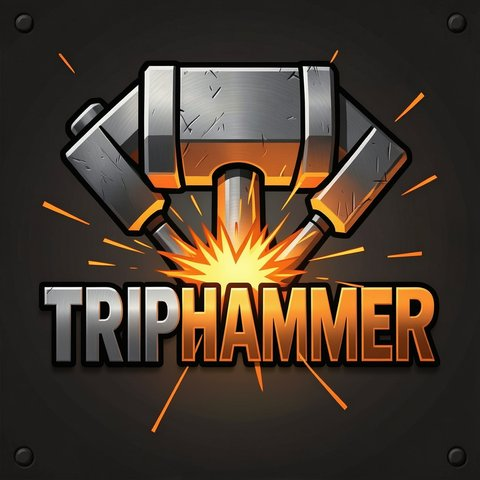

# Triphammer

<p align="center"></p>

Triphammer works through a GitHub repository's issues with Claude Code, unattended. Every ten minutes it picks the
next ready issue and starts a headless Claude Code session in a fresh clone (a separate working copy of the
repository). The session writes the change, has other agents review it and opens a pull request. If the project's
rules allow it, the pull request merges on its own. Otherwise it waits for your approval.

You steer Triphammer with issues and labels, and it keeps going until you stop it.

## The name

A trip hammer is a heavy hammer driven by a water wheel. Forges used them to beat out iron, and mills used them to
pound grain or paper pulp. As long as the wheel turned, the hammer kept striking without anyone swinging it. The smith
decided what went on the anvil and when to stop the wheel.

Triphammer runs on the same idea. A timer starts a run every ten minutes, and each run takes the next ready issue and
works on it. You choose the work with issues and labels, and the brakes under [Stop work](#stop-work) stop the wheel.

## What keeps it in bounds

Triphammer merges code without a person watching, so several limits apply to every change:

- The agents act through a GitHub App that can read and write contents, issues and pull requests, and nothing else.
  They can't change your CI workflows or your branch rules.
- Each pull request gets a risk tier from the project's rules, which decides whether it merges, waits for you or is
  refused.
- CI reads those rules from the default branch, never from the pull request, so a pull request can't loosen its own
  tier.
- A change no rule covers waits for you. A repository with no rules file sends every change to you.
- Each session Triphammer starts runs under an OS-level write limit that leaves only its clone, the temporary
  directories and the tools' own runtime and cache directories writable. The write limit and the runner hold the
  session's boundaries.
- Guard hooks in each session catch honest mistakes early, such as changing Triphammer's units or writing outside the
  session's clone, and say what to do instead. They read commands in their plain forms and are not a security
  boundary: a command written to get past them gets past them.
- A session that goes through three review rounds, each with a blocking problem, stops. It labels its issue
  `needs-owner` and explains what it needs from you.

The three tiers:

| Tier | What happens to the pull request |
| --- | --- |
| `auto` | It merges once the required checks pass. |
| `escalate` | It waits until you approve it on GitHub. |
| `blocked` | It doesn't merge. The rule's reason says what to do instead. |

## Requirements

- An Ubuntu server that runs only Triphammer, such as a VM. A project with a full build, a database per run and
  browser tests needs 4 to 8 vCPUs, 16 GB of memory and 100 GB of disk. A lighter project needs less.
- A GitHub App for the agents, created in your GitHub account's developer settings. Give it read and write access to
  contents, issues and pull requests, and nothing else. Install it on each account that owns one of your repositories.
- A Claude account for Claude Code.

## Install

Run these steps on the server, as a user who can use `sudo`.

1. Set up the machine:

   ```sh
   curl -fsSL https://raw.githubusercontent.com/TreyThomasDotCodes/triphammer/main/install.sh | bash
   ```

2. Put the App's three files in `/home/triphammer/.config/github-app/`, each owned by `triphammer` with mode 600:
   - `app-id`: the App's numeric ID.
   - `owner`: the account the App is installed on.
   - `agents.pem`: the App's private key.
3. Log Claude Code in. The command prints a URL you can open on any machine:

   ```sh
   sudo -iu triphammer claude auth login
   ```

The installer sets up git, ShellCheck, Docker, Node, the GitHub CLI and Claude Code. It creates a `triphammer` user and
clones Triphammer to `/srv/triphammer`. For that user it installs the Triphammer plugin and the humanizer plugin, which
comes from the `blader/humanizer` marketplace on GitHub. A project whose checks use Docker gets a rootless Docker
daemon that runs as a second user, `triphammer-docker`.

It asks for your password once, and it's safe to run again: it only changes what isn't right yet. To preview its
changes, end the line with `bash -s -- --dry-run` instead of `bash`. When it finishes, it lists what's still left for
you, each item with its fix, or says the machine is ready.

The installer never reads or writes a credential. That's why steps 2 and 3 are yours.

## Add a project

A project describes itself in two files in its own repository. Commit them to the default branch before you run
`triphammer add`, which reads the project's name from the first one.

### Describe the project

`.triphammer/project.json` names the project and the commands that build and test it. Only `name` is required:

```json
{
  "name": "my-project",
  "checks": {
    "build": "make build",
    "focused": "make test TEST=<file>",
    "suite": "make test"
  }
}
```

`build` builds the project, `focused` runs one test file and `suite` runs every test. The file can also name a review
checklist, extra review skills and a skill that checks UI changes.

### Write the risk rules

`.triphammer/risk-tier.json` decides each change's tier from the paths it touches. Each path is a regular expression,
and for each file the first rule that matches wins. A file no rule matches escalates, with `unmatchedReason` as the
reason. This example escalates agent instructions and lets application code and tests merge on their own:

```json
{
  "rules": [
    {
      "why": "Agent instructions and Triphammer rules need the owner.",
      "tier": "escalate",
      "paths": ["(^|/)(AGENTS\\.md|CLAUDE\\.md|\\.claude|\\.triphammer)(/|$)"],
      "reason": "agent instructions or workflow rules"
    },
    {
      "why": "Application code and tests merge when CI passes.",
      "tier": "auto",
      "paths": ["^src/", "^tests/"]
    }
  ],
  "unmatchedReason": "outside the areas that merge automatically"
}
```

Every `escalate` or `blocked` rule needs a `reason`.

### Add the workflow and protect the branch

Add this workflow to the project as `.github/workflows/risk-tier.yml`:

```yaml
name: risk-tier
on:
  pull_request:
    types: [opened, reopened, synchronize, edited, ready_for_review, labeled, unlabeled]
  pull_request_review:
    types: [submitted, dismissed]
permissions:
  contents: read
  issues: read
  pull-requests: write
  statuses: write
jobs:
  risk-tier:
    uses: TreyThomasDotCodes/triphammer/.github/workflows/risk-tier.yml@<commit>
```

Replace `<commit>` with the full SHA of a commit on Triphammer's `main`. The workflow runs Triphammer's checks from that
commit, with the rules from your default branch, and nothing from the pull request. To pick up newer checks, move the
pin forward. If an organization owns the repository, set the variable `TRIPHAMMER_OWNER` to your own login, on the
repository or the organization.

Then protect the default branch with three required checks: `closing-issue`, `owner-approval` and your tests. The
workflow posts the first two. `closing-issue` passes when the pull request closes an issue, and `owner-approval` passes
when the change's tier allows it to merge.

### Start it

On the server:

```sh
triphammer add <owner>/<repo>
triphammer start <project>
```

`<project>` is the `name` from `.triphammer/project.json`.

`triphammer add` clones the repository to `/srv/<repo>`, installs the toolchains it pins, writes the project's config
and creates any labels Triphammer needs. It then runs the doctor, which lists anything missing and how to fix it. The
timers aren't on yet, so the doctor skips them until you run `triphammer start`, which turns them on.

You can run `triphammer add` again at any time. It keeps your existing settings and prints what each one ended up as.
To change a setting, use `--set KEY=VALUE`, `--modules` or `--app-author`. To remove one, use `--unset KEY`.

The Configuration section of [`bin/README.md`](bin/README.md#configuration) lists every field.

## Approve a pull request

When a pull request escalates, Triphammer requests your review and labels it `needs-owner`. Approve it on GitHub to let
it merge. If its changes move after you approve, it needs your approval again. To send it back, request changes, and a
new session works through your review.

A pull request you open yourself, such as a change under `.github/workflows/` that the App can't push, needs no
approval: `owner-approval` passes at any commit you pushed. If someone else pushes to its branch, that commit waits for
you as usual.

## Day to day

Write an issue. Triphammer takes any open issue that you or the App opened, once the issues it depends on are closed.
Say what an issue waits for on a line of its own:

```text
Depends on #12.
Slice 2 of #10.
```

A slice is one part of a larger parent issue, and it waits for the slice before it. Triphammer closes the parent once
its last slice closes. The `next` label moves a ready issue to the front of the queue.

When there's nothing else to do, Triphammer opens an upkeep issue once a week. That session audits what merged since
the last upkeep, files an issue for each problem it finds, reports on the upkeep issue and closes it. It opens no pull
request.

### Stop work

- Label an issue or pull request `hold` or `needs-owner` to stop work on it.
- Open an issue labelled `stop-agents` to stop that project.
- Create a file named `stop` in `~/.local/state/triphammer/`, as the `triphammer` user, to stop every project on the
  machine.

Each of these also stops a session already working on it. To resume, remove the label, close the issue or delete the
file.

### See what it's doing

```sh
triphammer plan     # what the next run will do
triphammer doctor   # what's missing or wrong on the machine
```

With more than one project, name the one you mean, as in `triphammer plan <project>`.

The status page lists what's waiting on you, then each project's current run, log, recent runs and queue. It listens on
`127.0.0.1:8787`. [`status/README.md`](status/README.md) explains how to reach it safely from another machine.

## Updating

Triphammer keeps most of itself current. Each run fast-forwards Triphammer's checkout and the project's, and sessions
load the plugin from Triphammer's checkout.

What the installer put in place as root doesn't update itself: the packages and Node, the `triphammer` command in
`/usr/local/bin`, the plugins and each project's toolchains. When a project pins a new .NET SDK or Playwright, or
Triphammer's setup changes, run:

```sh
triphammer update             # or triphammer update --dry-run, to preview
```

It reruns the setup for the machine and each project, keeping each project's settings. It reloads the units if one
changed, runs each project's doctor and ends with the same list of what's left for you as the installer. Nothing runs
it on a schedule, because it changes things as root.

[`bin/README.md`](bin/README.md) covers every option, the configuration, and running Triphammer on a machine you also
use for other things.

## Optional modules

Modules are off unless a project's config lists them in `MODULES`, which `triphammer add --modules` sets.

- `demo` records a walkthrough of each web UI change and publishes it to a small gallery.
- `qwen-audit` repeats the weekly audit with a local model behind an Anthropic Messages API server, for a second
  opinion.
- `codex` adds Codex to the weekly audit, runs a monthly security audit and reviews the security of pull requests that
  touch Triphammer's own code. If that review finds something, a repair session starts, and the reviewed commit doesn't
  merge until that session's follow-up is recorded.

`triphammer add` and `triphammer update` write the `codex` module's defaults into a project's config when they're
missing:

```text
CODEX_SECURITY_MODEL=gpt-daybreak-blue-latest
CODEX_AUDIT_MODEL=gpt-6.1-sol
CODEX_WEEKLY_CAP=500
CODEX_FLOOR_PERCENT=0
CODEX_RUN_PERCENT=1
```

The Modules section of [`bin/README.md`](bin/README.md) explains each one.

## Use only the plugin

The skills, agents and guard hooks are a Claude Code plugin, and they work in an interactive session too:

```sh
claude plugin marketplace add TreyThomasDotCodes/triphammer
claude plugin install triphammer@triphammer --scope user
```

## Development

```sh
npm run test:tooling
```

The tests use fakes for `gh`, `claude`, `docker`, `curl` and the package tools, so they need no network and no
credentials. [`AGENTS.md`](AGENTS.md) has the rules for changes, including the ones Triphammer makes to itself.

## License

MIT. [`CREDITS.md`](CREDITS.md) lists the code and ideas Triphammer adapts from other projects.
